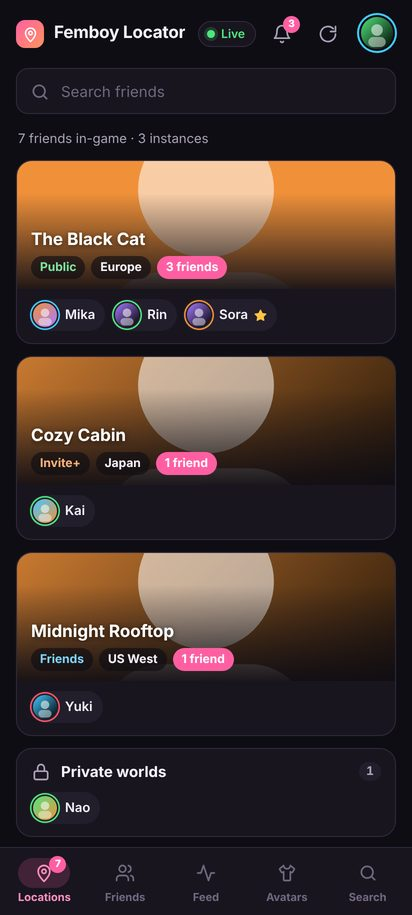
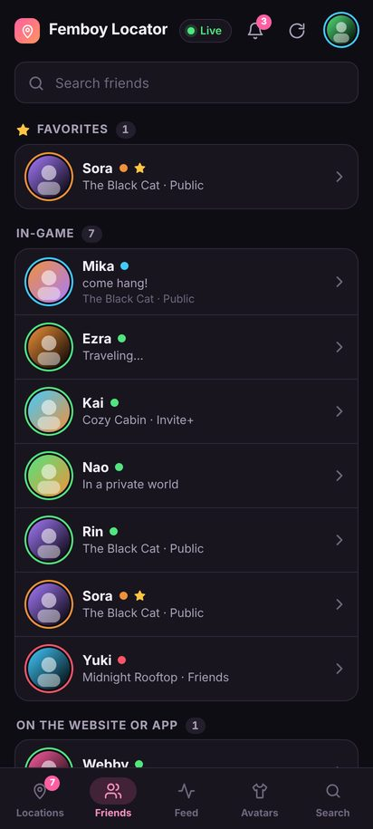
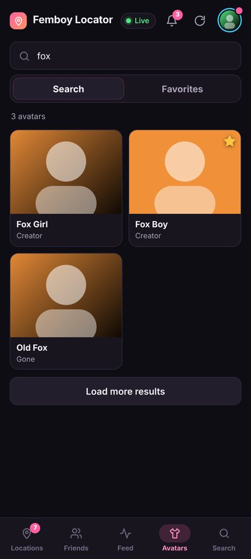

# Femboy Locator

See where your VRChat friends are, live, on your phone or your PC.

### [⬇ Android](https://github.com/SNUFFLES-boop/Femboy-Locator-Releases/releases/download/android-latest/FemboyLocator.apk) · [⬇ Windows](https://github.com/SNUFFLES-boop/Femboy-Locator-Releases/releases/latest/download/FemboyLocator_Setup_x64.exe)

macOS: [Apple Silicon](https://github.com/SNUFFLES-boop/Femboy-Locator-Releases/releases/latest/download/FemboyLocator_macOS_AppleSilicon.dmg) · [Intel](https://github.com/SNUFFLES-boop/Femboy-Locator-Releases/releases/latest/download/FemboyLocator_macOS_Intel.dmg) ·
Linux: [x64](https://github.com/SNUFFLES-boop/Femboy-Locator-Releases/releases/latest/download/FemboyLocator_Linux_x64.AppImage) · [arm64](https://github.com/SNUFFLES-boop/Femboy-Locator-Releases/releases/latest/download/FemboyLocator_Linux_arm64.AppImage) ·
Windows [portable zip](https://github.com/SNUFFLES-boop/Femboy-Locator-Releases/releases/latest/download/FemboyLocator_Windows_Portable.zip)

  

## What it does

- **Live locations**: friends grouped by world and instance, updated live.
- **Friends and feed**: who's online, and a feed of joins, status and avatar changes.
- **Avatar search**: search public avatars and wear them from your phone.
- **Unlimited saved avatars** in your own lists, with backup and import.
- **Invites and notifications**: join friends, accept requests, answer invites.
- **Make it yours**: themes, colours, backgrounds. Updates install from inside the app.

## How to install (Android)

1. Tap **Download for Android** on your phone.
2. Open `FemboyLocator.apk`. If Android asks, allow your browser to install apps.
3. Log in with your VRChat account. You sign in directly with VRChat; your password is never saved.
4. Later updates show up in the app: open your profile and tap **Update now**.

## How to install (Windows)

Run `FemboyLocator_Setup_x64.exe`. If SmartScreen says it protected your PC, click **More info → Run anyway**
(it shows for new apps that aren't code-signed yet). The app updates itself when a new version is out.

## Credits

Made by **Deltro**.

---

Femboy Locator is not endorsed by VRChat and does not reflect the views or opinions of VRChat or anyone officially
involved in producing or managing VRChat properties. VRChat and all associated properties are trademarks or registered
trademarks of VRChat Inc.

This repository only hosts the app downloads and this page.
